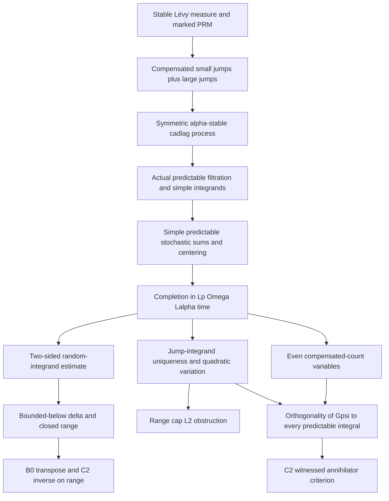

# Stable Lévy dependency graph

Target parameters: `1 < p < α < 2`. Intended domain is the predictable
subspace of `Lp(Ω; Lα(0,T))`; intended operator is the actual stochastic
integral `δu = ∫₀ᵀ uₜ dLₜ`. No such process or integral is constructed in the
rewrite. The following arrows are proof obligations, not accomplished
implications in Lean.

The already verified B0/C2 results start **after** an actual bounded
`δ : H →L[ℝ] Lp` and a positive lower bound have been supplied. They prove
that such a `δ` has closed range and a continuous inverse onto that range;
they do not supply `δ` or the lower bound. C1 handles an unbounded densely
defined operator and its true Banach adjoint independently of any process.

The candidate inequality
`c‖u‖_{Lp(Ω;Lα)} ≤ ‖∫u dL‖_{Lp(Ω)} ≤ C‖u‖_{Lp(Ω;Lα)}`
must be checked for **random predictable** `u`. Deterministic stable
scaling and a deterministic compensated-Poisson L² isometry do not establish
it. The older manuscript explicitly takes a stable-scale isomorphism as an
assumption near `Banach.tex:552`; the Lean rewrite has not discharged it.

For `range(δ) ∩ L² = {0}`, one needs a rigorous implication from finite
second moment of a predictable integral to vanishing of its jump integrand.
The infinite stable second moment by itself is insufficient without proving
how predictable coefficients enter quadratic variation and excluding
component cancellations. For a bounded even `ψ` supported away from zero,
`Gψ = ∫ψ dN - T∫ψ dν` is an L² candidate. To use C2's annihilator criterion
one must prove, for **every** admissible predictable `u`, both the Hölder
pairing's integrability and `E[Gψ δu]=0`, plus nonzero pairing with a proposed
target. The legacy universal reflection-parity argument does not establish
that claim, because a predictable integrand can depend on past jumps.

Shortest concrete path: verify a finite-intensity time-mark Poisson measure;
construct the simple predictable compensated integral and its L² isometry;
then separately develop stable truncation, Lp completion and the random
predictable two-sided estimate. None of the last three steps is currently a
Lean theorem here.
