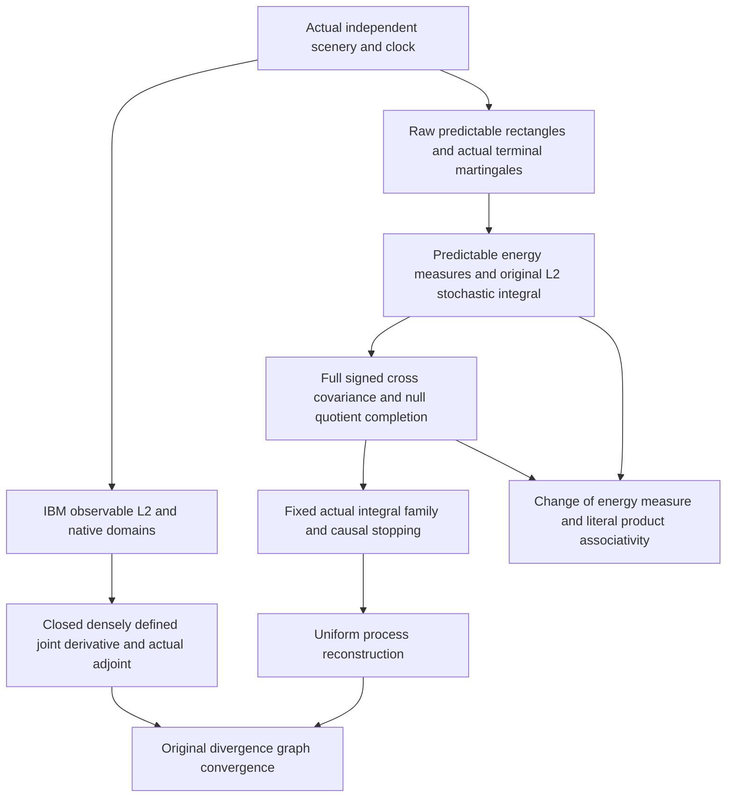

# Stardust mathematical blueprint

This curated map explains major verified relationships, not all declarations.
Lean source and exact audited theorem types are authoritative. Names below
have prefix `OperatorDerivativeRewrite.Foundation.`. The current campaign and
its gates live in [the queue](STARDUST_CAMPAIGN_QUEUE.md); earlier campaign
documents retain historical stage labels. This map changes no priority.

Navigate: [operators](#operators-and-domains) · [Gaussian](#gaussian-realizations)
· [signed heat](#signed-higher-order-heat-calculus) · [IBM](#actual-ibm-calculus)
· [Xi flows](#arithmetic-xi-flows) · [connections](#connections-and-obligations).

## Operators and domains

`operatorDerivative` is the Hilbert adjoint of a partially defined divergence.
`operatorDerivative_isClosed` and `operatorDerivative_adjoint_identity` require
a dense divergence domain; the latter uses elements of BOTH actual domains.
Source: [Adjoint](Foundation/Adjoint.lean).

[OperatorDomains](Foundation/OperatorDomains.lean),
[AdjointClosure](Foundation/AdjointClosure.lean), and
[MultiplierCore](Foundation/MultiplierCore.lean) supply domain/graph/multiplier
tools. An abstract adjoint does not construct a stochastic process, analytic
product rule or adapted integral. Such identifications need separate proofs.

## Gaussian realizations

[GaussianHermiteAdjoints](Foundation/GaussianHermiteAdjoints.lean) proves, in the
ONE-coordinate Gaussian model, `GaussianCore.closedDerivative_eq_divergence_adjoint`
and `closedDivergence_eq_derivative_adjoint`, then mutual closed-adjoint identities.
Hermite graph approximations prove these equalities; they are not assumptions.
[GaussianHermiteDomains](Foundation/GaussianHermiteDomains.lean) gives weighted
coefficient domains. Finite-dimensional and countable-product developments have
their own scopes: do not infer their full-domain identifications from this row.

The actual countable Gaussian product and first-chaos laws support the scenery
and clock processes used by IBM. See [the mathematical audit](MATHEMATICAL_AUDIT.md)
and [historical foundation overview](docs/FOUNDATION_OVERVIEW_LEGACY.md).
For a subtle boundary, `InfiniteGaussian.polynomialDivergence_core_iff_adjoint_identification`
in [InfiniteGaussianFiniteSectors](Foundation/InfiniteGaussianFiniteSectors.lean)
proves an EQUIVALENCE of two core-identification statements, not either assertion.
Check downstream results before treating an old “open” label as current.

## Signed higher-order heat calculus

Definition chain: actual finite-dimensional signed laws -> analytic cylinder
core -> factorial-weighted common Banach completion
`HigherHeatAnalyticCylinderDomain.Domain` -> dual-valued adapted coefficient
fields and bounded channel maps.

`HigherHeatCompletedClarkOcone.clark_ocone` reconstructs every completed
observable's centered signed pairing with all p-1 channels, p=2m, m>0, T>0.
`biharmonic_three_channels` spells out channels1,2,3. `channel_duality` specifies
the complementary derivative order and exact coefficient. The equality is in
the continuous TEST DUAL, not automatically in the observable Banach space.

`HigherHeatSignedDiagonalRealization.completed_signed_realization` supplies
genuine signed polynomial/grid approximations jointly converging in all
surviving coefficient L1 norms and reconstruction dual norm. A specially
justified diagonal is not every arbitrary degree/mesh sequence.

Sources: [Clark–Ocone](Foundation/HigherHeatCompletedClarkOcone.lean),
[signed diagonal realization](Foundation/HigherHeatSignedDiagonalRealization.lean),
[stopping contract](STARDUST_PSEUDOPROCESS_STOPPING_AUDIT.md).
No positive pseudo-L2 isometry or positive path-space law is inferred.

## Actual IBM calculus

The following arrows describe verified mathematical reuse. They are NOT an
automatically generated exhaustive Lean import graph.

**F1–F3 foundation.** `IBMDilatedPredictableLimit.correction_continuum_tendsto`
uses the established injective clock-number smoothing/common-dual topology.
`IBMCompactOriginalBoundary.originalPathIntegral_continuum_tendsto` treats the
literal F2 boundary-layer functional in ordinary clock L2. The original
`IBMJointIntrinsicDerivative.jointDerivative_closed` and `jointDerivative_dense`
establish the genuine native joint derivative/adjoint setting.
[Exact F1–F3 scope](IBM_F1_F3_VERIFIED_CHECKPOINT.md).

**Actual integration.** `IBMStochasticIntegratorEnergy.energy_change` proves
mu_(I_F H)=H² mu_F on the entire original predictable sigma algebra.
`IBMStochasticProductAssociativity.actual_associativity` proves I_F(HK)=I_(I_F H)(K)
for EVERY K in ORIGINAL L2(mu_(I_F H)).
`IBMCompletedBoundedAssociativity.actual_bounded_associativity` identifies
bounded common predictable multiplication with the OLD output-channel integral
for EVERY completed family input.
[Full domains and proof](IBM_INTEGRATOR_ENERGY_PRODUCT_ASSOCIATIVITY_AUDIT.md).

**Process convergence.** `IBMUniformStochasticReconstruction.actual_IBM_uniform`
reconstructs actual IBM uniformly on compact physical-time intervals in L2.
`uniform_actual` covers every continuous observable-L2 curve and ALL causal
horizons simultaneously. `uniform_native_graph` gives the corresponding
ORIGINAL divergence graph-norm convergence.
[Topology and limits](IBM_UNIFORM_STOCHASTIC_RECONSTRUCTION_AUDIT.md).

**Open physical-time obligations.** The raw IBM path is not the fixed-terminal
martingale P_rY. Current results do not construct a pathwise bracket, prove
L2 of a samplewise time supremum, or give a full physical-time Ito–Tanaka or
temporal-gradient Clark–Ocone formula. The derivative-domain exclusion for
the actual sine observation remains compatible with stochastic reconstruction.

## Arithmetic Xi flows

`RiemannQuarticUniformFarScale.eventually_all_zeros_real` proves unrestricted
global zero reality for every sufficiently late time of the ACTUAL growing
quartic theta-kernel flow. Local saddle disks and far-field estimates use one
compatible scale. See [the quartic stopping audit](A4_CAMPAIGN_STOPPING_AUDIT.md)
for later threshold/endpoint results and historical supersessions.

Integer and real-exponent flows have separate actual integral and evolution
theorems. `RiemannRealOrderLimit` proves order continuity/local uniform Fourier
limits with an integrable majorant.
`RiemannRealOrderZeroLimits.zero_of_order_and_zero_limits` requires a convergent
sequence of zeros; it does not prevent zeros from escaping to infinity.
[Integer/real-order stopping scope](A2K_REAL_ORDER_STOPPING_AUDIT.md).
Quartic real zeros and order continuity do not themselves prove RH.

## Connections and obligations

1. **Null consistency before completion — established mechanism.** Gaussian
   representation independence, IBM's full signed joint-energy quotient and
   pseudo-channel synthesis kernels all require the correct null relation.
   Diagonal-only component energies cannot replace the actual joint relation.
2. **Uniform reconstruction transfer — proposed obligation.** IBM uses a positive,
   monotone Parseval error and compactness. Signed pseudo-pairings supply no
   such positive error. To obtain uniform signed grid realization for a compact
   family, prove a common native-approximation bound and presentation-consistent
   approximation first; pointwise diagonal existence alone is insufficient.
3. **Compact versus global control — shared limitation.** Uniform L2 control
   in IBM is not control of the samplewise supremum. Locally uniform entire
   functions are not global zero localization. Each stronger topology requires
   its own estimate, not a change in terminology.

The [commentary](STARDUST_MATHEMATICAL_COMMENTARY.md) gives concrete follow-ups
and classifies their proof status. They are opportunities, not queue amendments.
